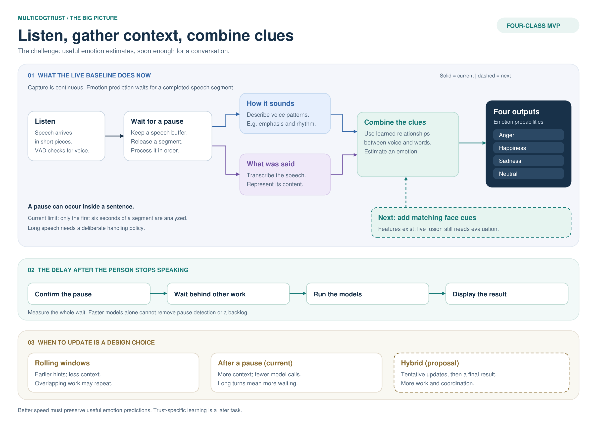

# MultiCogTrust: ideas, choices, and challenges

**For an incoming college junior.** Focus on the decisions we face; equations and library details can follow later.

## 1. What are we trying to learn?

Imagine a robot makes a mistake. The person says, "That's fine," in a tense voice. Can combining words, delivery, and expression give a more useful emotion estimate, quickly enough to support an interaction?

Our laptop MVP predicts **anger, happiness, sadness, or neutral**, using a common IEMOCAP subset that merges happiness and excitement. The eventual goal is understanding **trust in the robot**, but emotion alone cannot establish trust. Someone can be annoyed and still rely on a robot, or smile while distrusting it.

**Where we are:** an audio/text baseline works, and visual feature extraction exists. We must test whether vision earns its extra cost, then integrate it live. Robot hardware is optional. See the [roadmap](async_multimodal_pipeline_roadmap.md) for results and remaining work.

[Open the diagram as a PDF](../output/pdf/multicogtrust_inference.pdf).

## 2. When should we make a prediction?

**Inference** means using a trained model on a new observation. **Voice activity detection (VAD)** answers whether speech is happening. It does not transcribe words or recognize the end of a grammatical sentence.

Today, VAD checks roughly 32-millisecond audio chunks. Our wrapper buffers speech and releases a segment after roughly 0.3 seconds of silence. Completed segments are processed one at a time: transcribe, analyze, report. **The full emotion model runs per segment, not per tiny chunk.** A mid-sentence pause can split the sentence. See the [speech worker](../src/audio/vad.py) and [inference path](../src/inference_pipeline.py).

There are three useful design choices:

| Approach | Benefit | Cost or difficulty |
|---|---|---|
| **Rolling window:** periodically analyze the most recent few seconds while the person speaks | Earlier feedback; no need to wait through a long turn | Incomplete words and context can change the answer. Overlapping windows may repeatedly process the same audio |
| **Wait for a speech segment:** predict after a pause, as we do now | More context and fewer repeated model calls; easier to evaluate | The person waits longer. Pauses can occur mid-sentence, and uninterrupted speech can delay the result |
| **Hybrid:** occasional provisional updates, then a final result after the pause | Early feedback plus a chance to revise with more context | More computation and coordination; the interface must distinguish a tentative result from a final one |

Waiting for an actual *whole sentence* requires more than VAD: punctuation or a turn-ending model may help, but conversational sentences can trail off or be interrupted.

**Suggested MVP direction:** establish reliable results after pauses, gather visual observations during speech, then test provisional updates. Define a maximum segment length and a policy for continuing long speech. Currently only the **first six seconds** reach the model; the remainder is discarded. A new windowing policy needs evaluation because training used utterances, not arbitrary fragments.

## 3. What does fusion mean?

**Fusion combines evidence to make one prediction.** Words provide content; audio preserves delivery, such as pitch and rhythm; video adds facial movement. Clues can agree, conflict, or be unavailable. None guarantees a reading of someone's internal state.

Each branch creates a numerical description, often called an **embedding**. The transcript and its embedding represent the same text modality. Speech and its transcript also share a source: they provide different clues, but their errors are not independent.

| Fusion approach | Basic idea | Trade-off |
|---|---|---|
| **Combine predictions (late fusion)** | Each branch makes an emotion prediction; combine those predictions | Easy to compare and design fallbacks, but may miss interactions between the original clues |
| **Combine representations (feature fusion)** | Bring the branches' numerical descriptions together before deciding | Can learn combinations such as positive words with tense delivery; requires compatible timing and missing-input handling |
| **Cross-attention** | A form of feature fusion that learns which parts of one stream relate to parts of another | More flexible, but adds computation and does not automatically know which sensor is reliable |

Our MemoCMT-style baseline uses speech/text cross-attention. The next comparison adds vision. Compare complex fusion with simple prediction averaging: extra complexity must earn its cost. Read [MemoCMT](https://www.nature.com/articles/s41598-025-89202-x) and [MulT](https://aclanthology.org/P19-1656/) for the underlying research.

## 4. How can we make inference faster?

The delay a person experiences includes more than the neural network:

**After-speech delay ≈ waiting to confirm the pause + waiting behind other work + model processing + displaying the result.**

Our two-second response budget after speech ends remains a target. Measure typical delays and slow cases: **p95 latency** is the time within which 95% of measured responses finish.

Practical steps, in order:

1. **Measure the whole path on the Mac.** Time pause detection, queued work, transcription, speech/text analysis, visual processing, and display. Speeding up a small part may barely help.
2. **Avoid unnecessary work.** Keep models loaded; test compact models, fewer video frames, and fewer provisional updates. Using less precise numbers (**quantization**) may help, but needs hardware and accuracy checks.
3. **Work while the person speaks.** Analyze face frames in the background. Incremental speech/text processing needs more design because later words can change earlier representations. Repeatedly analyzing a growing recording can increase total work.
4. **Control the backlog.** If one worker needs 0.8 seconds per update but receives requests every 0.5 seconds, requests pile up. Limit preview frequency or replace obsolete previews. Define how final utterances are retained or dropped; bounded queues alone do not ensure fresh results.
5. **Check the trade-off.** Shorter silence thresholds may split phrases. Smaller models may make more mistakes. Batching can increase throughput—work completed per second—while making an individual person wait longer.

We already use compact speech/text models. Freezing their weights or caching training features does not remove inference work on new speech. A responsive interface also need not have a fast prediction. The [faster-whisper benchmarks](https://github.com/SYSTRAN/faster-whisper) illustrate runtime trade-offs; measure our Mac separately.

## 5. What could make a convincing demo misleading?

- **Mismatched evidence:** a facial reaction must belong to the same person and relevant time as the speech. Combining unrelated frames and words can teach the wrong relationship.
- **Missing or misleading clues:** looking away, poor light, background noise, or transcription errors can damage a branch. Missing video should be marked unavailable, not treated as a neutral expression. Plan an audio/text fallback and test it.
- **Different conditions:** IEMOCAP contains acted interactions. Success there does not establish performance with new people talking to a real robot. Human-written transcripts also make an easier test than live transcription.
- **Unfair comparisons:** compare with/without vision using the same examples and development budget. Learn on Sessions 1–3, make design choices on Session 4, and reserve Session 5 for final evaluation. Check each emotion, rather than accepting a high overall score that hides weak classes.

The most useful contribution may be better accuracy, comparable accuracy with less delay, or evidence that a simpler system is sufficient.

## 6. Reading and a self-check

Start with these short readings; skip equations on the first pass:

| Reading | Question to answer afterward |
|---|---|
| [IEMOCAP overview](https://sail.usc.edu/iemocap/) | What observations and labels do we actually have? |
| [MemoCMT](https://www.nature.com/articles/s41598-025-89202-x): abstract and architecture figure | What do speech and text each contribute, and where are they combined? |
| [Turning Whisper into a Real-Time Transcription System](https://aclanthology.org/2023.ijcnlp-demo.3/): abstract/introduction | Why does a model that handles recordings need extra machinery for live speech? |
| [Lee & See: trust in automation](https://pubmed.ncbi.nlm.nih.gov/15151155/): abstract | Why is trust a separate research question from recognizing emotion? |

When ready to code, follow the [README](../README.md). Names to recognize: **Python/PyTorch** runs the system; **Silero** finds speech; **Whisper** transcribes; **DistilHuBERT/DistilBERT** represent speech/text; **OpenCV, MediaPipe, and MobileNet** process vision.

**Self-check:** explain these without looking. Score each: 0 = stuck, 1 = with notes, 2 = independent explanation with an example.

1. A person pauses in the middle of "That was ... not what I wanted." What might our current pipeline do? What would change with rolling predictions?
2. The words sound positive but the delivery sounds tense. What could fusion learn, and why is a simple majority vote insufficient?
3. The camera loses the face. What should the system report or use instead?
4. We halve model processing time, but the demo still feels slow. What else should we measure?
5. What happens when update requests arrive faster than one worker can finish them?
6. What experiment would convince you that adding video is worthwhile?

Answer checkpoints

1. VAD may split the phrase at the pause. Rolling predictions arrive earlier but can change when the rest arrives; previews need clear labeling.
2. Fusion can learn relationships between words and delivery. Sources differ in reliability and share information; disagreement is evidence to learn from, not a rule proving one emotion.
3. Mark the visual input unavailable and use a tested fallback, such as the audio/text baseline. Do not invent a neutral face or silently reuse an old one.
4. Pause confirmation, queue waiting, transcription, other processing, and display. Separate startup from normal operation and inspect slow cases.
5. The backlog and age of predictions grow. Reduce work or update rate, or use an explicit policy for obsolete requests.
6. Keep the evaluation conditions fixed, compare emotion quality and full response delay, and include missing-video and live-transcription cases. Use held-out data only after selecting the design.

**First contribution:** draw a conversation timeline with pauses, possible prediction times, and changing interpretations. Bring a proposed timing policy and a way to test it. Aim for 10/12; discuss gaps with your mentor.
