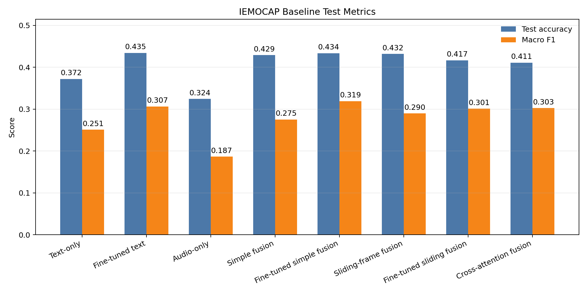
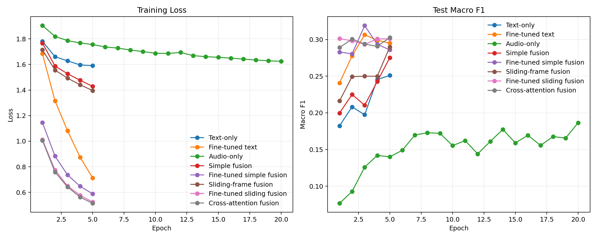
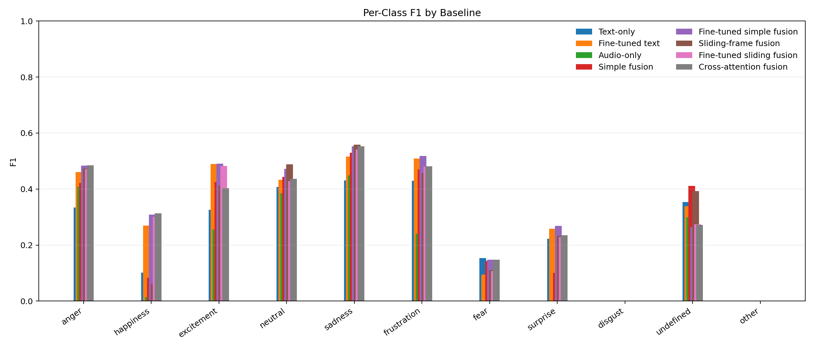
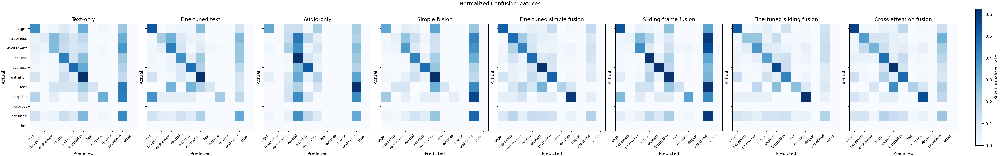

# IEMOCAP Baseline Visualization Notes

## Scope

These visualizations summarize the full baseline run over `data/iemocap_aligned_features`.
The split has 7867 train examples and 2170 test examples,
using the existing 11-label IEMOCAP mapping:
anger, happiness, excitement, neutral, sadness, frustration, fear, surprise, disgust, undefined, other.

## Files

| Figure | File |
| --- | --- |
| Aggregate metric comparison | `baseline_metric_comparison.png` |
| Training curves | `baseline_training_curves.png` |
| Per-class F1 | `baseline_per_class_f1.png` |
| Normalized confusion matrices | `baseline_confusion_matrices.png` |

## Figure Previews

## Headline Result

Best macro F1 in this comparison is **Fine-tuned simple fusion** (0.3190).
Existing simple fusion improves macro F1 by **+0.0242** over text-only and
**+0.0886** over audio-only. That is a modest but real signal that
token-aligned prosody adds useful information in the pooled-fusion setup.
Fine-tuned DistilBERT directly updates the text encoder on IEMOCAP. Its macro F1 is **0.3065**, which is **+0.0555** versus the frozen text baseline.
Sliding-frame fusion uses the raw `audio_frame_features` sequence directly. Its macro F1 is **+0.0145** versus the existing word-aligned simple fusion baseline.

## Sliding-Window Embedding Check

Token-pooled sliding-window features matched existing word-aligned features for 3/256 sampled records (max absolute difference 0.000488281). Token-overlap pooling from sliding frames differs from existing word_audio_features.

## Model Comparison

| Model | Accuracy | Macro F1 | Best epoch | Train loss | Test loss |
| --- | ---: | ---: | ---: | ---: | ---: |
| Text-only | 0.3724 | 0.2510 | 5 | 1.5901 | 1.6419 |
| Fine-tuned text | 0.4346 | 0.3065 | 3 | 1.0810 | 1.5700 |
| Audio-only | 0.3244 | 0.1866 | 20 | 1.6244 | 1.7185 |
| Simple fusion | 0.4290 | 0.2752 | 5 | 1.4286 | 1.5128 |
| Fine-tuned simple fusion | 0.4336 | 0.3190 | 3 | 0.7364 | 1.8890 |
| Sliding-frame fusion | 0.4318 | 0.2897 | 5 | 1.3961 | 1.5098 |
| Fine-tuned sliding fusion | 0.4166 | 0.3012 | 1 | 1.0124 | 1.6976 |
| Cross-attention fusion | 0.4111 | 0.3026 | 5 | 0.5142 | 2.1575 |

## Visual Reading Guide

- `baseline_metric_comparison.png` is the quickest view. Macro F1 ranks as:
  Fine-tuned simple fusion (0.3190), Fine-tuned text (0.3065), Cross-attention fusion (0.3026), Fine-tuned sliding fusion (0.3012), Sliding-frame fusion (0.2897), Simple fusion (0.2752), Text-only (0.2510), Audio-only (0.1866).
- `baseline_training_curves.png` shows learning dynamics across the frozen, fusion,
  and fine-tuned text settings.
- `baseline_per_class_f1.png` shows the class imbalance pain points. Sadness is easiest
  across all models, while rare or ambiguous labels such as disgust, fear, surprise,
  happiness, and other remain difficult.
- `baseline_confusion_matrices.png` shows where mistakes concentrate. The models frequently
  confuse undefined, frustration, neutral, and excitement, which are also semantically and
  annotationally close in parts of IEMOCAP.

## Per-Model Details

### Text-only

- Best class by F1: **sadness** (0.431).
- Weakest class by F1: **disgust** (0.000).
- Most common off-diagonal confusions: undefined -> frustration (131), excitement -> undefined (100), neutral -> frustration (90), neutral -> undefined (81), sadness -> frustration (71), undefined -> neutral (65).

### Fine-tuned text

- Best class by F1: **sadness** (0.516).
- Weakest class by F1: **disgust** (0.000).
- Most common off-diagonal confusions: undefined -> frustration (109), neutral -> undefined (93), neutral -> frustration (90), excitement -> undefined (73), undefined -> neutral (65), undefined -> anger (63).

### Audio-only

- Best class by F1: **sadness** (0.450).
- Weakest class by F1: **fear** (0.000).
- Most common off-diagonal confusions: undefined -> neutral (197), frustration -> undefined (126), frustration -> neutral (120), excitement -> neutral (115), neutral -> undefined (87), undefined -> sadness (85).

### Simple fusion

- Best class by F1: **sadness** (0.530).
- Weakest class by F1: **disgust** (0.000).
- Most common off-diagonal confusions: undefined -> frustration (125), neutral -> undefined (118), excitement -> undefined (113), neutral -> frustration (81), frustration -> undefined (62), happiness -> undefined (59).

### Fine-tuned simple fusion

- Best class by F1: **sadness** (0.553).
- Weakest class by F1: **disgust** (0.000).
- Most common off-diagonal confusions: undefined -> happiness (94), undefined -> neutral (81), undefined -> sadness (72), undefined -> frustration (65), excitement -> happiness (61), frustration -> neutral (58).

### Sliding-frame fusion

- Best class by F1: **sadness** (0.559).
- Weakest class by F1: **disgust** (0.000).
- Most common off-diagonal confusions: excitement -> undefined (134), neutral -> undefined (105), frustration -> undefined (91), undefined -> frustration (89), undefined -> neutral (71), happiness -> undefined (69).

### Fine-tuned sliding fusion

- Best class by F1: **sadness** (0.541).
- Weakest class by F1: **disgust** (0.000).
- Most common off-diagonal confusions: undefined -> frustration (76), undefined -> neutral (68), undefined -> sadness (65), frustration -> anger (64), neutral -> undefined (60), undefined -> anger (60).

### Cross-attention fusion

- Best class by F1: **sadness** (0.553).
- Weakest class by F1: **disgust** (0.000).
- Most common off-diagonal confusions: undefined -> neutral (98), undefined -> sadness (74), frustration -> neutral (71), neutral -> undefined (68), undefined -> frustration (66), excitement -> undefined (65).

## Interpretation

The text-only classifier is already a strong baseline despite the frozen DistilBERT encoder,
which suggests lexical content carries a lot of emotion signal in this split. The fine-tuned
text benchmark tests whether updating DistilBERT should be treated as the overall text
ceiling before adding multimodal fusion. The audio-only GRU captures some useful prosodic
structure, especially for sadness, but struggles with several low-support or overlapping
classes. The word-aligned and sliding-frame fusion models test whether prosody is more
useful after word-level aggregation or as a separate temporal sequence.

The next experiment should preserve token-level text/prosody alignment but replace the
pooled concatenation with early-fusion self-attention or a small cross-modal attention block.
The goal is to let the model decide which words should attend to which prosodic frames
instead of averaging each modality independently before classification.
