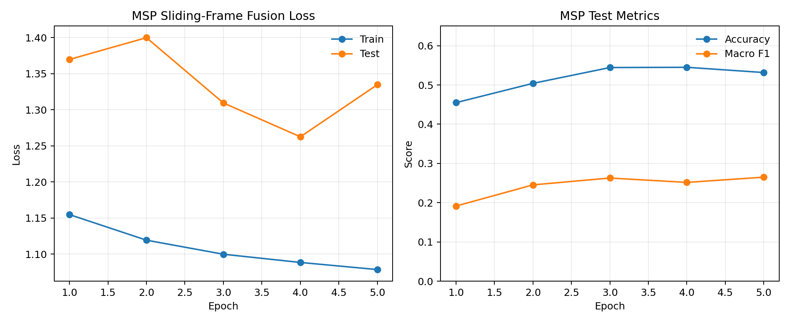
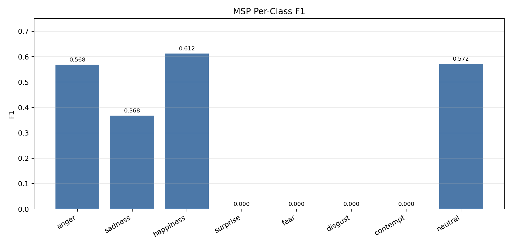
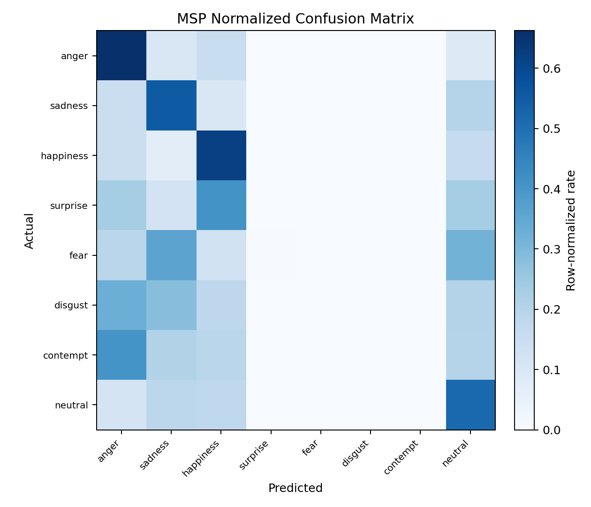

# MSP-PODCAST Baseline Visual Report

## Scope

These figures summarize the full MSP-PODCAST sliding-frame fusion run over `msp_aligned_features` with 123370 train examples and 36327 test examples.

## Result

- Best epoch: 5
- Test accuracy: 0.5316
- Test macro F1: 0.2650
- Strongest class by F1: happiness (0.612)
- Weakest class by F1: surprise (0.000)
- Largest confusions: neutral -> sadness (2289), neutral -> happiness (2204), happiness -> neutral (1789), happiness -> anger (1596), neutral -> anger (1458)

## Files

| Figure | File |
| --- | --- |
| Training curves | `msp_training_curves.png` |
| Per-class F1 | `msp_per_class_f1.png` |
| Normalized confusion matrix | `msp_confusion_matrix.png` |

## Figures

